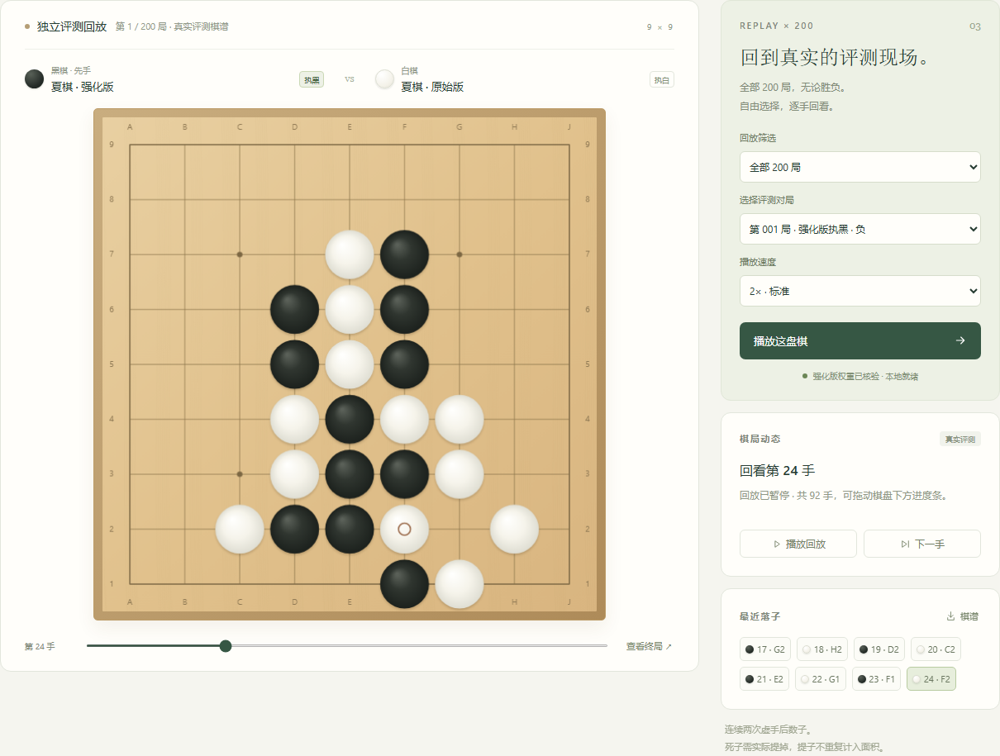
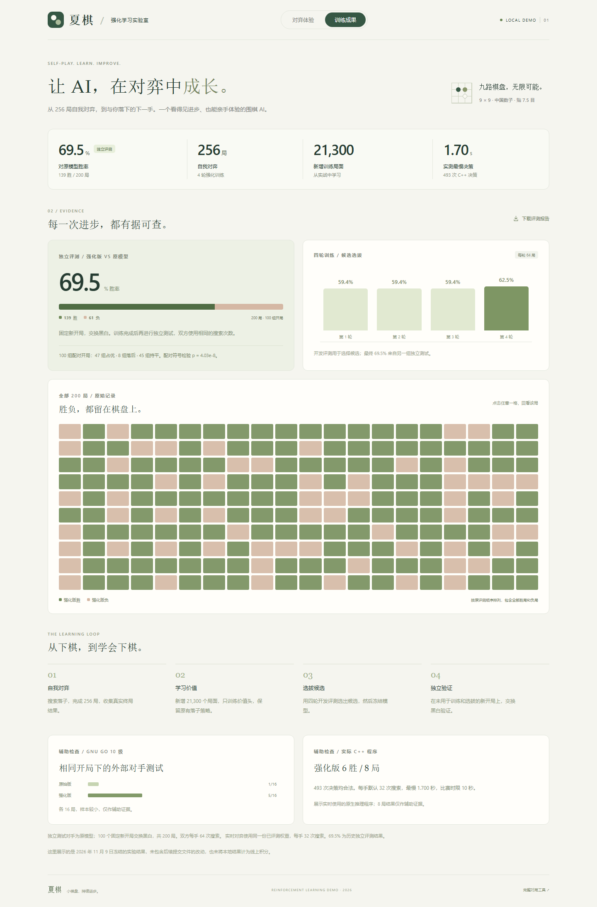

# 夏棋 · 强化学习 Demo

一个可直接体验的九路围棋 AI 演示：挑战强化模型、观看强化版与原版对战、回放全部 200 局独立评测。

**[下载 Windows 演示包](https://github.com/zkwxd/xiaqi/raw/refs/heads/codex/rl-go-demo-20261114/xiaqi-demo-windows.zip)** · [评测报告](demo/data/report.md) · [完整使用说明](demo/README.md)



## 快速开始

需要 **Windows 和 Python 3.11+**。解压演示包或克隆本分支，双击根目录的 `start-demo.cmd`。首次启动安装网页服务依赖，随后自动打开浏览器；不需要 Docker、显卡或训练框架。

```powershell
git clone --branch codex/rl-go-demo-20261114 --single-branch https://github.com/zkwxd/xiaqi.git
cd xiaqi
.\start-demo.cmd
```

默认地址为 http://127.0.0.1:8000；端口占用时依次尝试到 8010。保持启动窗口运行，按 Ctrl+C 结束服务。对局保存在本机 `data/demo.db`。

## 可以演示什么

- **挑战 AI**：执黑或执白，与冻结的强化版权重实时对弈，支持虚手、认输、回看和 SGF 导出。
- **AI 对战**：强化版与原始版使用同一推理程序、不同权重，支持自动对战、暂停和逐手走棋。
- **评测回放**：全部 200 局真实棋谱，包含 139 胜和 61 负，可筛选、调速、拖动手数及查看终局数子。
- **训练成果**：四轮训练数据、完整胜负矩阵、辅助评测和可下载报告。
- **完整对局工具**：原有界面保留在 `/arena`。

## 结果与口径

| 项目 | 结果 |
| --- | --- |
| 自我对弈训练 | 4 轮 × 64 局，共 256 局 |
| 新增训练局面 | 21,300 个 |
| 独立评测，对手为原模型 | 139 胜 / 200 局，胜率 69.5% |
| 独立开局安排 | 100 个固定新开局，交换黑白 |
| 原生程序辅助检查 | 强化权重 6 胜 / 8 局；493 次决策均合法 |
| 规则 | 9×9、中国数子、贴 7.5 目、全局同形、连续两次虚手终局 |

主评测双方每手 64 次搜索，实时演示每手 32 次搜索。69.5% 是 2026 年 11 月 9 日冻结实验中对原模型的历史胜率，不代表线上积分或通用棋力等级。小样本辅助检查仅作补充证据。



## 文件与验证

- `demo/web/`：演示页面，无外部字体或网页资源依赖。
- `demo/models/`：冻结的 C++ 源码、Windows 推理程序、两份权重和校验清单。
- `demo/data/`：完整评测棋谱、训练统计及报告。
- `demo/build_demo.py`：校验模型、重放全部 200 局并生成演示包，不依赖原训练目录。
- `backend/`：规则、对局服务和测试。

重新打包与后端测试：

```powershell
.\.venv\Scripts\python.exe demo\build_demo.py --package
.\.venv\Scripts\python.exe demo\verify_package.py
.\.venv\Scripts\python.exe -m pytest backend\tests -q
```

压缩包的 SHA256 见 [xiaqi-demo-windows.sha256](xiaqi-demo-windows.sha256)，冻结文件的来源与校验和见 [模型来源](demo/models/README.md)。

浏览器完整流程检查见 `demo/check-demo.cjs`；在项目目录安装 Playwright 并安装其 Chromium 后运行 `node demo/check-demo.cjs`。可通过 `XIAQI_DEMO_URL` 指向其他本地端口，通过 `PLAYWRIGHT_CHROMIUM_EXECUTABLE` 指定现有浏览器。
